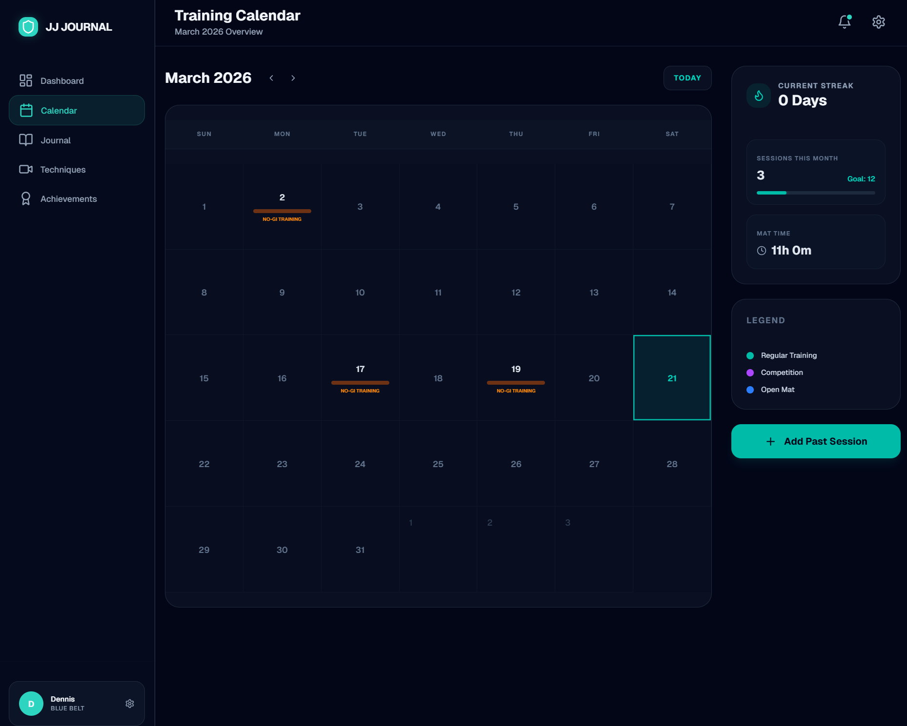
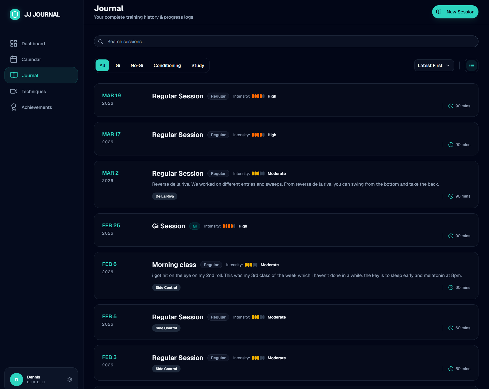
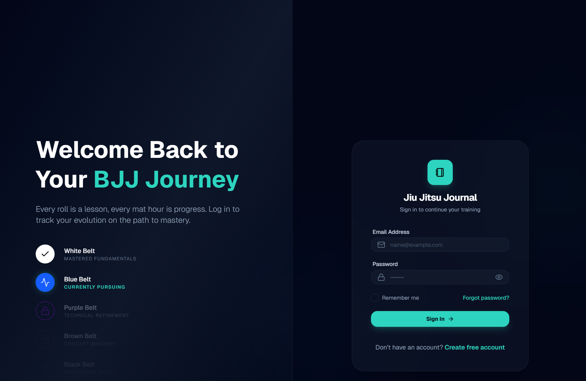

<p align="center">
  
</p>

<h1 align="center">BJJ Journey</h1>

<p align="center">
  <strong>Your complete Brazilian Jiu Jitsu training companion</strong>
</p>

<p align="center">
  
  
  
  
  
</p>

<p align="center">
  Track your sessions. Document your techniques. Celebrate your progress.
</p>

<p align="center">
  <a href="https://bjj-journey.netlify.app/"></a>
</p>

---

## About

BJJ Journey is a full-stack web app for tracking your Brazilian Jiu Jitsu training. Log daily sessions, document techniques with video references, monitor attendance patterns, track belt progression, and celebrate achievements on your path to black belt.

## Screenshots

<details open>
<summary><strong>Training Dashboard</strong></summary>
<br />

<p><em>Real-time stats including total sessions, monthly progress, current streak, training volume chart, and recent activity feed.</em></p>
</details>

<details>
<summary><strong>Training Calendar</strong></summary>
<br />

<p><em>Interactive calendar view with session types, mat time tracking, streak counter, and quick session logging.</em></p>
</details>

<details>
<summary><strong>Journal</strong></summary>
<br />

<p><em>Filterable training log with session types, intensity levels, duration, technique tags, and full-text search.</em></p>
</details>

<details>
<summary><strong>Progress Tracking</strong></summary>
<br />

<p><em>Belt progression timeline, stripe progress, milestone checklist, and promotion history.</em></p>
</details>

<details>
<summary><strong>Authentication</strong></summary>
<br />

<p><em>Secure login with belt progression visualization and responsive glassmorphism design.</em></p>
</details>

## Features

- **Training Dashboard** - At-a-glance stats: total sessions, monthly progress, current streak, and training volume chart
- **Interactive Calendar** - Visual calendar with session type indicators, mat time tracking, and quick-add
- **Journal Entries** - Log sessions with notes, intensity level, duration, and session type (Gi, No-Gi, Open Mat)
- **Technique Library** - Save techniques with YouTube links and personal notes
- **Progress Tracking** - Belt progression timeline, stripe milestones, and promotion history
- **Achievement System** - Record belt promotions and stripe achievements with dates
- **Goal Setting** - Monthly training frequency goals with progress bars
- **Dark Mode** - Full dark theme with glassmorphism UI and smooth transitions
- **Responsive** - Works seamlessly on desktop, tablet, and mobile

## Tech Stack

| Layer | Technologies |
|-------|-------------|
| **Frontend** | Next.js 16, React 19, TypeScript 5, Tailwind CSS 4, Radix UI, Framer Motion |
| **Backend** | Next.js API Routes (serverless) |
| **Database** | PostgreSQL (Neon) + Drizzle ORM |
| **Auth** | NextAuth.js 4 (JWT strategy) |
| **Data Fetching** | TanStack Query 5 |
| **Validation** | Zod + React Hook Form |

## Getting Started

### Prerequisites

- Node.js 18+
- PostgreSQL database ([Neon](https://neon.tech) recommended)

### Setup

```bash
# Clone the repository
git clone https://github.com/dennisrongo/bjj-journey.git
cd bjj-journey

# Install dependencies
npm install

# Set up environment variables
cp .env.example .env
# Edit .env with your DATABASE_URL, NEXTAUTH_URL, and NEXTAUTH_SECRET

# Push database schema
npm run db:push

# Start development server
npm run dev
```

Open [http://localhost:3000](http://localhost:3000) to get started.

### Environment Variables

| Variable | Description |
|----------|-------------|
| `DATABASE_URL` | PostgreSQL connection string |
| `NEXTAUTH_URL` | Base URL (`http://localhost:3000` for dev) |
| `NEXTAUTH_SECRET` | Secret key - generate with `openssl rand -base64 32` |

## Scripts

```bash
npm run dev          # Start dev server
npm run build        # Production build
npm run lint         # ESLint
npm test             # Run tests
npm run db:push      # Push schema to database
npm run db:studio    # Open Drizzle Studio GUI
```

## Project Structure

```
app/
  api/               # REST API routes (auth, journal, techniques, achievements)
  auth/              # Login & signup pages
  dashboard/         # Main dashboard
  calendar/          # Training calendar
  journal/           # Journal entries
  techniques/        # Technique library
  achievements/      # Progress tracking
  settings/          # User settings
components/
  ui/                # Radix UI primitives
  navigation/        # Sidebar & mobile nav
  progress/          # Progress tracking components
lib/
  db/                # Drizzle schema & connection
  hooks/             # TanStack Query hooks
  validations/       # Zod schemas
  api/               # Fetch client
  auth.ts            # NextAuth config
```

## Contributing

1. Fork the repository
2. Create a feature branch (`git checkout -b feature/amazing-feature`)
3. Commit your changes
4. Push to the branch
5. Open a Pull Request

## License

This project is open source and available under the [MIT License](LICENSE).

---

<p align="center">
  <strong>Built for the BJJ community</strong>
</p>
