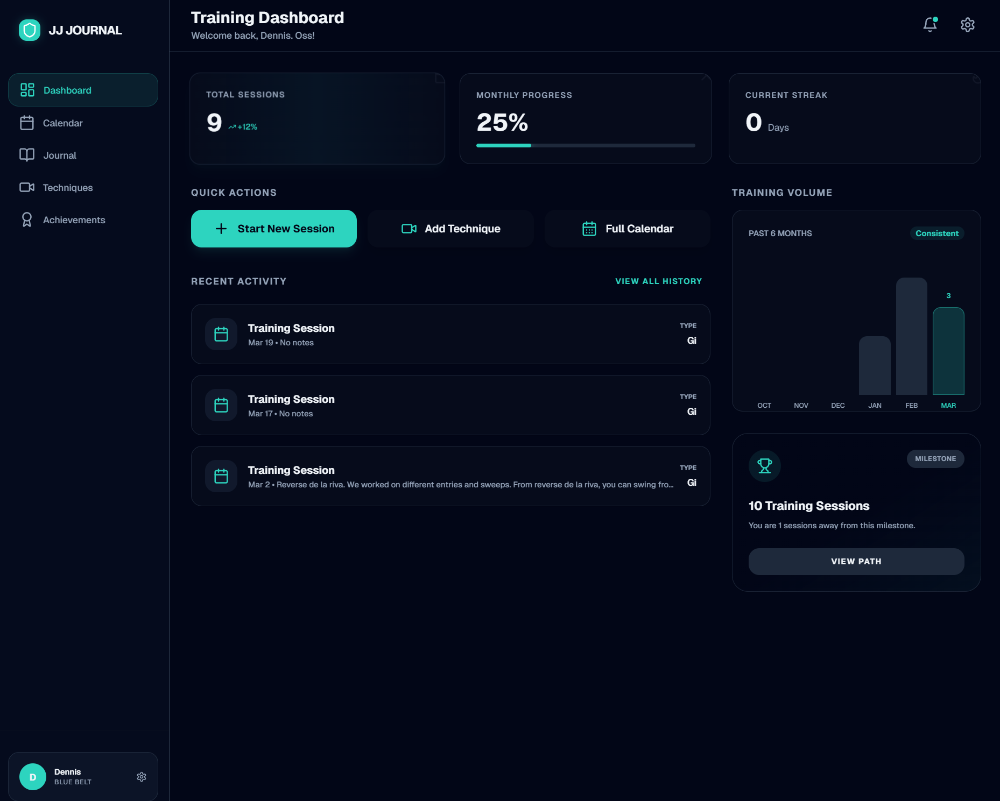
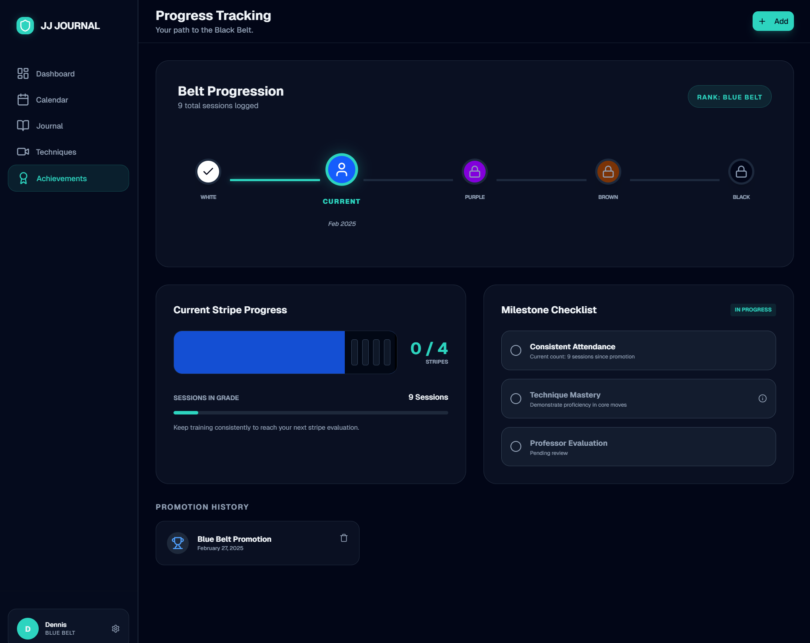

<p align="center">
  
</p>

<h1 align="center">BJJ Journey</h1>

<p align="center">
  <strong>Your complete Brazilian Jiu Jitsu training companion</strong>
</p>

<p align="center">
  
  
  
  
  
</p>

<p align="center">
  Track your sessions. Document your techniques. Celebrate your progress.
</p>

<p align="center">
  <a href="https://bjj-journey.netlify.app/"></a>
</p>

---

## About

BJJ Journey is a full-stack web app for tracking your Brazilian Jiu Jitsu training. Log daily sessions, document techniques with video references, monitor attendance patterns, track belt progression, and celebrate achievements on your path to black belt.

## Screenshots

<details open>
<summary><strong>Training Dashboard</strong></summary>
<br />

<p><em>Real-time stats including total sessions, monthly progress, current streak, training volume chart, and recent activity feed.</em></p>
</details>

<details>
<summary><strong>Training Calendar</strong></summary>
<br />

<p><em>Interactive calendar view with session types, mat time tracking, streak counter, and quick session logging.</em></p>
</details>

<details>
<summary><strong>Journal</strong></summary>
<br />

<p><em>Filterable training log with session types, intensity levels, duration, technique tags, and full-text search.</em></p>
</details>

<details>
<summary><strong>Progress Tracking</strong></summary>
<br />

<p><em>Belt progression timeline, stripe progress, milestone checklist, and promotion history.</em></p>
</details>

<details>
<summary><strong>Authentication</strong></summary>
<br />

<p><em>Secure login with belt progression visualization and responsive glassmorphism design.</em></p>
</details>

## Features

- **Training Dashboard** - At-a-glance stats: total sessions, monthly progress, current streak, and training volume chart
- **Interactive Calendar** - Visual calendar with session type indicators, mat time tracking, and quick-add
- **Journal Entries** - Log sessions with notes, intensity level, duration, and session type (Gi, No-Gi, Open Mat)
- **Technique Library** - Save techniques with YouTube links and personal notes
- **Progress Tracking** - Belt progression timeline, stripe milestones, and promotion history
- **Achievement System** - Record belt promotions and stripe achievements with dates
- **Goal Setting** - Monthly training frequency goals with progress bars
- **Dark Mode** - Full dark theme with glassmorphism UI and smooth transitions
- **Responsive** - Works seamlessly on desktop, tablet, and mobile

## Tech Stack

| Layer | Technologies |
|-------|-------------|
| **Frontend** | Next.js 16, React 19, TypeScript 5, Tailwind CSS 4, Radix UI, Framer Motion |
| **Backend** | Next.js API Routes (serverless) |
| **Database** | PostgreSQL (Neon) + Drizzle ORM |
| **Auth** | NextAuth.js 4 (JWT strategy) |
| **Data Fetching** | TanStack Query 5 |
| **Validation** | Zod + React Hook Form |

## Getting Started

### Docker self-hosting

On Intel/AMD NAS hosts, use `compose.single.yaml` to pull one image with the app and PostgreSQL from GitHub Container Registry. See the Docker guide for configuration, registry sign-in and data migration.

Use [Docker Compose with PostgreSQL and Cloudflare Tunnel](docs/docker.md) to run BJJ Journey on your own host.

### Prerequisites

- Node.js 20 and pnpm 10, matching CI
- A dedicated Neon PostgreSQL development database

### Setup

From the repository root:

```bash
pnpm install --frozen-lockfile
cp .env.example .env
```

Set `DATABASE_URL`, `NEXTAUTH_URL` (usually `http://localhost:3000`) and `NEXTAUTH_SECRET` in the ignored `.env` file. Generate the secret with `openssl rand -base64 32`. Supply the database URL to the migration process, then start the app.

```bash
node --env-file=.env scripts/migrate-training.mjs --check
node --env-file=.env scripts/migrate-training.mjs --apply
node --env-file=.env scripts/seed-training-catalog.mjs --apply
pnpm dev
```

See the [migration runbook](docs/training-migrations.md) for upgrades from an existing database and the [athlete platform architecture](docs/athlete-platform.md) for data ownership, training calculations and content provenance.

## Athlete performance

- **Training** includes mobility, strength, conditioning, solo drills and recovery exercise libraries, templates and live workouts.
- **Calendar** schedules sessions, recurring activities and rest days, and opens workouts and journal logging from planned activities. Reminders appear in the app.
- **Recovery and Progress** track optional readiness inputs, discomfort history, completed training load, benchmarks and goals.
- **Programmes and Competitions** provide editable training plans, BJJ strength templates and event preparation.
- **Journal and Settings** include session and weekly reflections, training units, time zone, account export and account deletion.

An already-open workout accepts edits when connectivity drops and syncs after reconnecting. Starting and completing a workout require a connection. Readiness guidance and training load trends are informational. Wearable and external calendar integrations are reserved for future work.

## Scripts

```bash
pnpm dev                                  # Start Next.js with hot reload
pnpm build                                # Build for production
pnpm lint                                 # Run ESLint
pnpm exec tsc --noEmit --incremental false # Check TypeScript
pnpm test                                 # Run Jest
pnpm test:coverage                        # Check Jest coverage
```

## Project Structure

```
app/
  api/               # REST API routes (auth, journal, techniques, achievements)
  auth/              # Login & signup pages
  dashboard/         # Main dashboard
  calendar/          # Training calendar
  journal/           # Journal entries
  techniques/        # Technique library
  achievements/      # Progress tracking
  settings/          # User settings
components/
  ui/                # Radix UI primitives
  navigation/        # Sidebar & mobile nav
  progress/          # Progress tracking components
lib/
  db/                # Drizzle schema & connection
  hooks/             # TanStack Query hooks
  validations/       # Zod schemas
  api/               # Fetch client
  auth.ts            # NextAuth config
```

## Contributing

1. Fork the repository
2. Create a feature branch (`git checkout -b feature/amazing-feature`)
3. Commit your changes
4. Push to the branch
5. Open a Pull Request

## License

This project is open source and available under the [MIT License](LICENSE).

---

<p align="center">
  <strong>Built for the BJJ community</strong>
</p>
